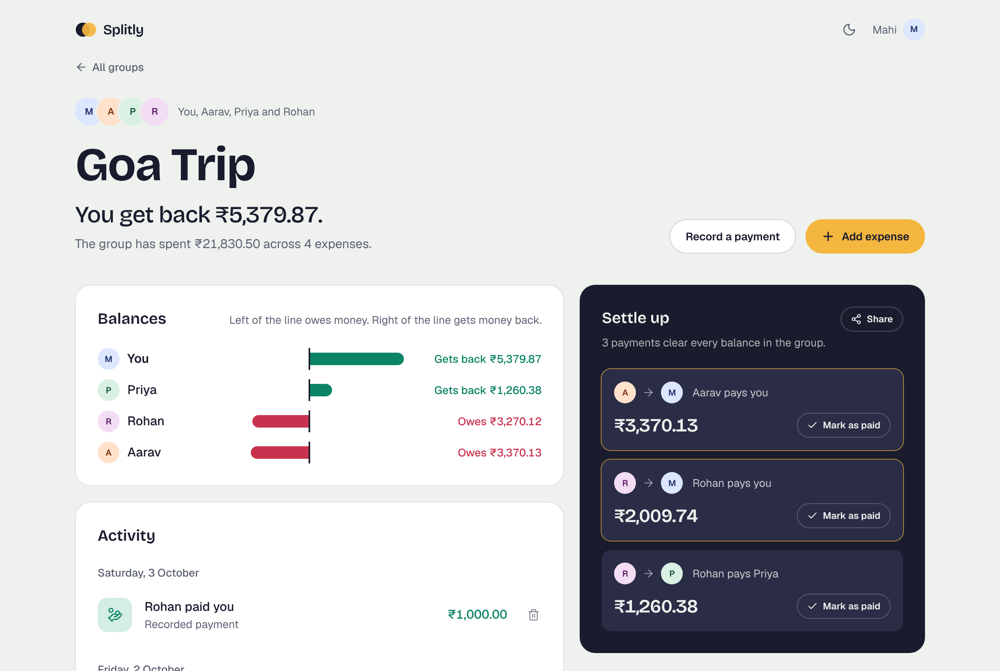
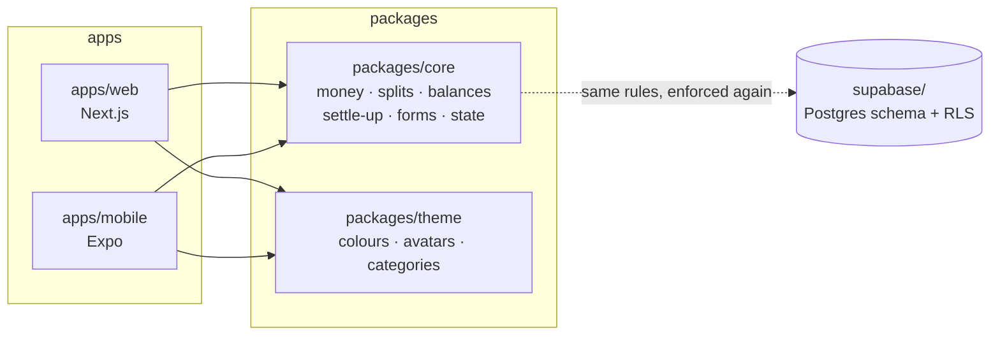

# Splitly

**Split shared expenses with friends and settle up in as few payments as possible.**

One TypeScript codebase for **web (Next.js)** and **mobile (Expo / React Native)**. All the money logic lives in one shared, fully tested package, so both apps always agree to the last paisa.

[](https://github.com/Mahiisss/splitly/actions/workflows/ci.yml)




## At a glance

| | |
| --- | --- |
| **2 apps, 1 codebase** | Next.js web app and Expo mobile app sharing logic, validation, state and design tokens |
| **115 unit tests** | Splitting, balances, settle-up, forms, saving and loading, all in Vitest |
| **24 database security checks** | The real Postgres schema runs in memory and every access rule is tested |
| **11 browser tests × 2 screen sizes** | Playwright clicks through the real app on a desktop and a phone on every push |
| **0 floating-point money** | Every amount is a whole number of paise, so totals never drift |

## Features

- **Groups for everything:** a trip, your flat, office lunches. The home screen shows your balance in each group and overall.
- **Edit a group any time:** rename it, add people who joined late, or remove someone who isn't part of any expense yet (people with expenses are protected, so balances never break).
- **Three ways to split a bill:** equally, by shares (2 shares for the person with the bigger room), or exact amounts. The form shows each person's share as you type, and for exact amounts tells you how much is left to assign.
- **Settle up in the fewest payments:** everyone's balance becomes a short list of who pays whom. **Mark as paid** records a payment in one tap, and **Share** copies the plan for the group's WhatsApp chat.
- **Edit and delete with undo:** any expense reopens with its original split filled in, and nothing is lost to a mis-tap.
- **Balance chart:** a diverging bar chart with zero in the middle, so you see at a glance who is up and who is down.
- **Activity feed:** expenses and payments grouped by day, each showing "you lent" or "you borrowed".
- **Dark mode** that follows your device, with a toggle on the web and no white flash on load.
- **Works offline:** data is saved on the device, and older saves are upgraded automatically.
- **Accessible:** real form labels, full keyboard support, focus-trapped dialogs, and charts described in words for screen readers.

## Screenshots

| Your groups | Dark mode | Add an expense |
| --- | --- | --- |
|  |  |  |

| Mobile app | Mobile, dark mode |
| --- | --- |
|  |  |

## Tech stack

| Layer | Tech |
| --- | --- |
| Monorepo | npm workspaces, Turborepo |
| Web | Next.js 16 (App Router), React 19, Tailwind CSS 4 |
| Mobile | Expo SDK 57, Expo Router, React Native 0.86 |
| Shared logic | TypeScript (strict) |
| Testing | Vitest (logic), PGlite (database rules), Playwright (end-to-end) |
| Database | Supabase: Postgres with Row Level Security and RPC functions |
| CI | GitHub Actions: tests, type checks, lint, build and browser tests on every push |

## Architecture



```
splitly/
├── apps/
│   ├── web/          Next.js app: / (your groups) and /groups/[id]
│   │   └── e2e/      Playwright tests that click through the app
│   └── mobile/       Expo app: the same screens with Expo Router
├── packages/
│   ├── core/         Business logic and its tests: the heart of the app
│   └── theme/        Light and dark design tokens shared by both apps
├── supabase/
│   ├── migrations/   Postgres schema, Row Level Security, RPC functions
│   └── tests/        Security tests that run the real schema in PGlite
└── docs/screenshots/
```

Both apps are thin UI layers. Anything that could disagree between web and mobile (rounding, validation, who owes whom, what "undo" restores) lives in `packages/core` and is tested once.

## Getting started

You need **Node.js 22 or newer** (`node -v` to check).

```bash
npm install          # installs every app and package
npm test             # runs all tests (core logic + database security)
npm run dev:web      # web app at http://localhost:3000
npm run dev:mobile   # mobile app: scan the QR code with Expo Go
```

| Command | What it does |
| --- | --- |
| `npm run typecheck` | Type-checks every app and package |
| `npm run lint` | Lints the web app |
| `npm run build` | Production build of the web app |
| `npm run test:e2e` | Builds the web app and clicks through it in Chromium at desktop and phone sizes (first time only: `npx playwright install chromium`, or skip the download on Windows and use Edge: `$env:PLAYWRIGHT_CHANNEL="msedge"; npm run test:e2e`) |
| `npm test --workspace=@splitly/core -- --watch` | Re-runs the logic tests as you edit |

## How it works

<details>
<summary><b>Money is stored as whole paise, never floats</b></summary>

`0.1 + 0.2` is `0.30000000000000004` in JavaScript, so every amount, in the app and in the database (as `bigint`), is an integer number of paise: ₹12.50 is `1250`. `parseAmount("12.50")` reads what the user typed as text, so it never passes through a float.
</details>

<details>
<summary><b>Splitting a bill</b> (<code>packages/core/src/splits.ts</code>)</summary>

All three strategies always add up to the exact total:

- **Equal:** ₹10.00 between 3 people is 334 + 333 + 333 paise. The leftover paisa goes to the first person.
- **Shares or percentages:** the *largest remainder* method, so rounding never loses or invents a paisa.
- **Exact:** the user types each amount, and the expense is rejected unless they add up.
</details>

<details>
<summary><b>Settling up in few payments</b> (<code>packages/core/src/settle.ts</code>)</summary>

1. Split people into those who are owed money and those who owe money.
2. Sort both from largest to smallest.
3. Match the top debtor with the top creditor and pay the smaller amount. Whoever reaches 0 drops out.

Each payment clears at least one person, so *n* people never need more than *n − 1* payments, in O(n log n). A test checks this guarantee on 1,000 random groups.

**Known limitation:** greedy matching isn't always the true minimum. With balances `a: +4, b: +6, c: −1, d: −5, e: −4` it suggests 4 payments, but 3 are enough (e→a 4, d→b 5, c→b 1). Finding the exact minimum is NP-hard in general; a bitmask dynamic-programming solution is practical for groups of up to about 15 people and is the next planned improvement.
</details>

<details>
<summary><b>One state model for both apps</b> (<code>packages/core/src/store.ts</code>)</summary>

Two small reducers handle every change: one for the list of groups (create, delete, undo) and one for a single group (add, edit, delete, undo). Saved data is validated on load (version, types, and splits that must add up), so a corrupted save falls back to the sample data instead of crashing. Saves from the older single-group version are upgraded automatically.
</details>

<details>
<summary><b>Dark mode without a flash</b> (<code>packages/theme</code>)</summary>

Every colour is defined for light and dark in one file. The web app turns them into CSS variables, and a tiny script in `<head>` applies a saved choice before the page paints. The mobile app reads the phone's setting with `useColorScheme()` and rebuilds its styles only when it changes.
</details>

<details>
<summary><b>Server and browser always agree</b></summary>

The web page is rendered on the server and then made interactive in the browser, and React reports an error if the two produce different HTML. Two things could cause that, and both are handled:

- **Saved data** is loaded only after the page becomes interactive.
- **Dates** are formatted by hand in a fixed timezone (IST), because Node and browsers punctuate dates differently and a UTC server would put late-evening expenses on a different day.
</details>

<details>
<summary><b>Database security</b> (<code>supabase/</code>)</summary>

Every table has **Row Level Security**, so the database itself refuses to show a group's data to anyone outside it, even if the app has a bug. Expenses are created and edited through `create_expense()` and `update_expense()`, which check in one transaction that the splits add up and that everyone is in the group. Each expense carries an id generated on the device, so retrying after a lost connection never creates duplicates.

`supabase/tests/rls.test.mjs` runs the real migration in PGlite (Postgres compiled to WebAssembly) and checks 24 rules, such as "an outsider sees no expenses", "an outsider can't edit an expense" and "a split that doesn't add up is rejected".
</details>

<details>
<summary><b>Three layers of tests</b></summary>

- **Logic** (`packages/core`, Vitest): every split, balance, form rule and saved-data upgrade, including a property test over 1,000 random groups.
- **Database** (`supabase/tests`, PGlite): the real migration and its access rules.
- **End to end** (`apps/web/e2e`, Playwright): a real browser adds, edits and deletes expenses, records payments, edits groups and switches to dark mode, on a desktop screen and on a phone screen, and fails if the page logs any error. Running them on a phone size caught a real bug: the group page was wider than a 360px screen, which covered the delete buttons.
</details>

## Deploy the web app

1. Push this repo to GitHub.
2. On [vercel.com](https://vercel.com), choose **Add New → Project** and import the repo.
3. Set **Root Directory** to `apps/web`. Vercel detects Next.js and installs the workspace from the repo root.
4. Deploy, then put the URL in the **Live demo** line at the top of this README.

## Install the Android app

The APK is built in the cloud by Expo's free EAS Build service, so Android Studio isn't needed.

1. Create a free account at [expo.dev](https://expo.dev/signup).
2. Commit your changes, then run:

   ```bash
   cd apps/mobile
   npx eas-cli@latest login
   npm run build:apk
   ```

   The first time, answer **Yes** when it offers to create the EAS project and to generate an Android keystore.
3. After about 10–15 minutes it prints a link. Open it on your Android phone, download the APK and install it (you may need to allow installs from your browser).

The build settings live in `apps/mobile/eas.json`; the `preview` profile produces an installable `.apk`.

## Roadmap

- [x] Shared logic, database schema with security tests, web and mobile apps
- [x] Add, edit and delete expenses (equal, shares, exact) with undo; record payments; mark as paid
- [x] Multiple groups, edit groups, dark mode, share the settle-up plan
- [x] End-to-end tests on desktop and phone in CI
- [x] Data saved on the device, with automatic upgrades of older saves
- [ ] Sign-in and shared groups with Supabase, so friends see the same data
- [ ] Live updates with Supabase Realtime
- [ ] Offline queue on mobile that syncs when back online
- [ ] Optimal settle-up for small groups (bitmask DP)
- [ ] Search and filter the activity feed

## Author

**Mahi Soni**, React and React Native developer
[GitHub](https://github.com/Mahiisss) · [LinkedIn](https://www.linkedin.com/in/mahisoni45)
