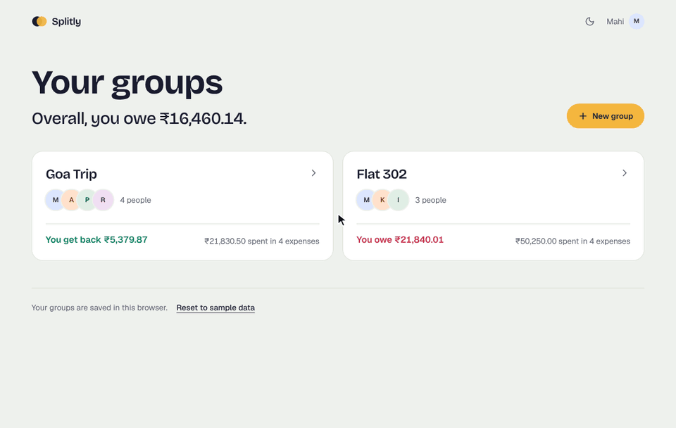
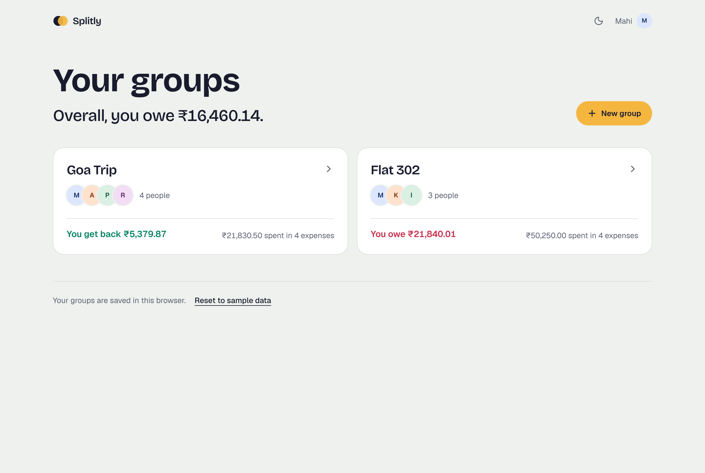
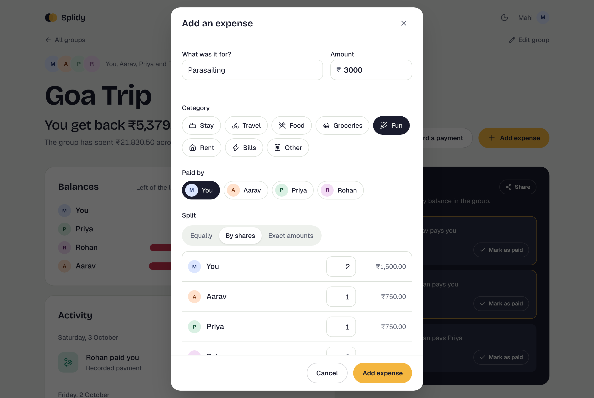
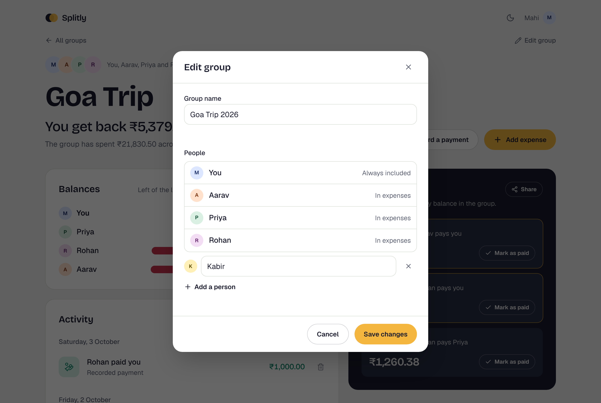
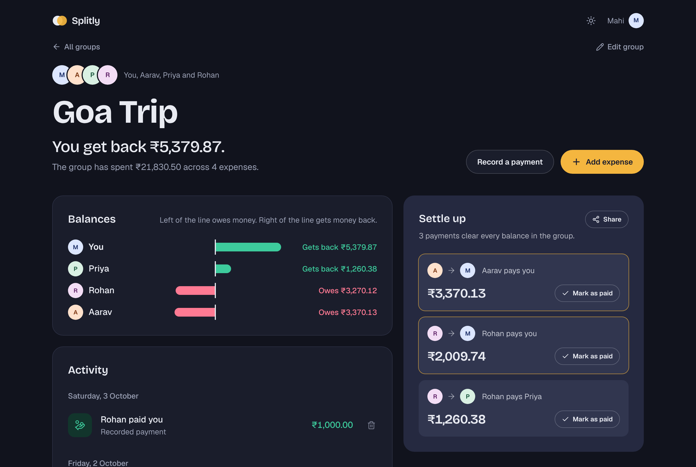
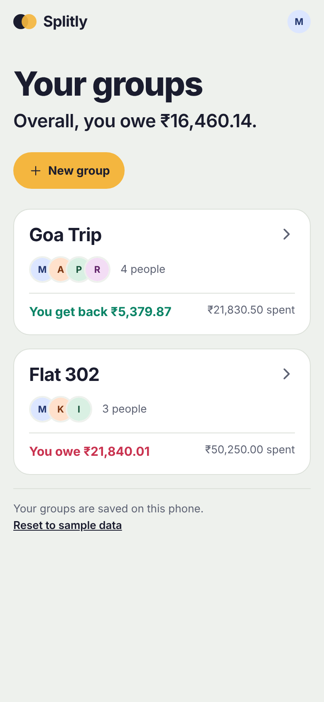
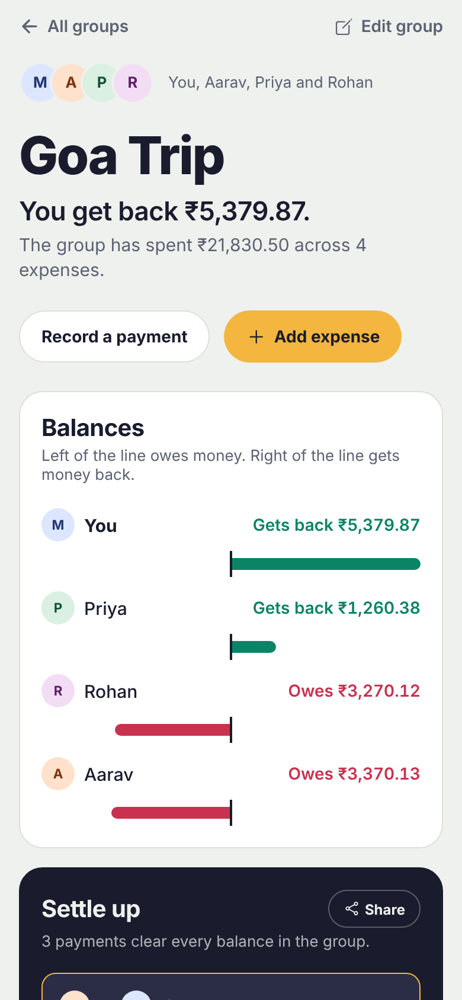
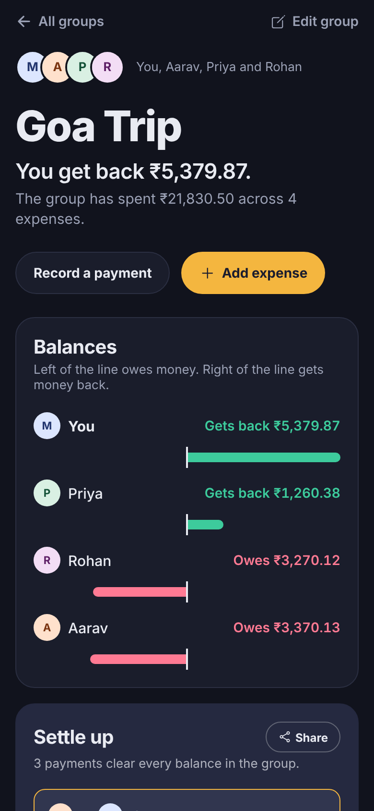
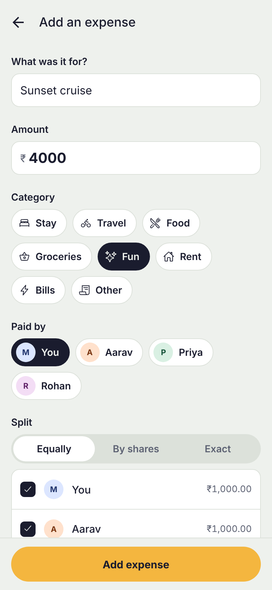
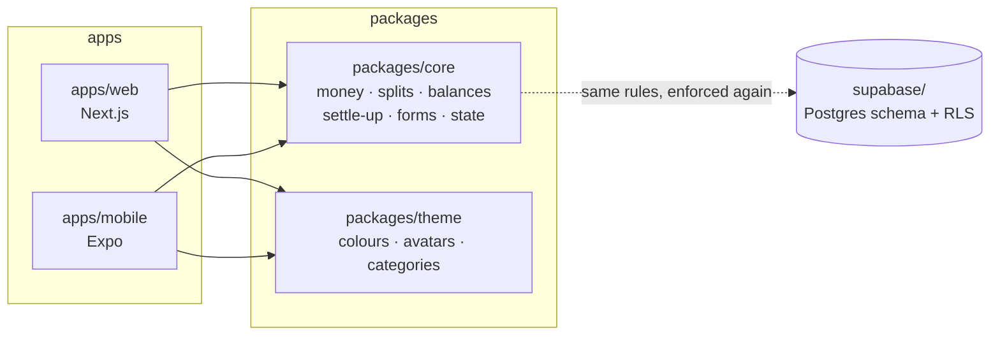

<p align="center">
  
</p>

<h1 align="center">Splitly</h1>

<p align="center">
  <b>Split shared expenses with friends, and settle up in as few payments as possible.</b><br />
  A Next.js web app and an Expo mobile app, built on one shared and fully tested TypeScript core.
</p>

<p align="center">
  <a href="https://github.com/Mahiisss/Splitly/actions/workflows/ci.yml"></a>
  
  
  
  
  
</p>

<p align="center">
  <a href="#features">Features</a> ·
  <a href="#screenshots">Screenshots</a> ·
  <a href="#how-it-works">How it works</a> ·
  <a href="#testing">Testing</a> ·
  <a href="#getting-started">Getting started</a>
</p>

<p align="center">
  
</p>

## Highlights

| | |
| --- | --- |
| **2 apps, 1 codebase** | The web and mobile apps share their logic, validation, state and design tokens, so they always agree to the last paisa |
| **Exact money** | Every amount is a whole number of paise and every split adds up exactly, with no floating-point drift |
| **Fewest payments** | Settle-up turns any set of balances into a short list of who pays whom: never more than *n − 1* payments |
| **3 layers of tests** | 115 unit tests, 24 database security checks and 11 browser tests at desktop and phone sizes, all run on every push |

## Features

**Splitting**

- **Groups for everything:** a trip, your flat, office lunches. The home screen shows your balance in each group and overall.
- **Three ways to split a bill:** equally, by shares (2 shares for the person with the bigger room), or exact amounts. Each person's share updates as you type, and exact splits show how much is still to assign.
- **Categories:** stay, travel, food, groceries, fun, rent, bills and other, each with its own icon and colour.

**Settling up**

- **Fewest payments:** everyone's balance becomes a short list of transfers.
- **Mark as paid:** opens the payment already filled in, so recording it is one more tap.
- **Share:** sends the plan to the group's WhatsApp chat through the share sheet, or copies it on a computer.
- **Balance chart:** a diverging bar chart with zero in the middle, so you see at a glance who is up and who is down.

**Everyday use**

- **Edit and delete with undo:** an expense reopens with its original split filled in, and nothing is lost to a mis-tap.
- **Edit groups:** rename a group, add people who joined late, or remove someone who isn't in any expense yet. People with expenses are protected, so balances never break.
- **Activity feed:** expenses and payments grouped by day, each showing "you lent" or "you borrowed".
- **Dark mode** that follows your device, with a toggle on the web and no white flash on load.
- **Works offline:** data is saved on the device, and saves from older versions are upgraded automatically.
- **Accessible:** real form labels, full keyboard support, focus-trapped dialogs, and charts described in words for screen readers.

## Screenshots

### Web

| Your groups | Add an expense |
| --- | --- |
|  |  |
| **Edit a group** | **Dark mode** |
|  |  |

### Mobile (Expo)

| Your groups | A group | Dark mode | Add an expense |
| --- | --- | --- | --- |
|  |  |  |  |

## Tech stack

| Layer | Tech |
| --- | --- |
| Web | Next.js 16 (App Router), React 19, Tailwind CSS 4 |
| Mobile | Expo SDK 57, Expo Router, React Native 0.86 |
| Shared logic | TypeScript (strict), in its own package |
| Database | Supabase: Postgres with Row Level Security and RPC functions |
| Testing | Vitest, PGlite (Postgres in WebAssembly), Playwright |
| Tooling | npm workspaces, Turborepo, ESLint, GitHub Actions, EAS Build |

## Architecture



```
splitly/
├── apps/
│   ├── web/          Next.js app: / (your groups) and /groups/[id]
│   │   └── e2e/      Playwright tests that click through the app
│   └── mobile/       Expo app: the same screens with Expo Router
├── packages/
│   ├── core/         Business logic and its tests: the heart of the app
│   └── theme/        Light and dark design tokens shared by both apps
├── supabase/
│   ├── migrations/   Postgres schema, Row Level Security, RPC functions
│   └── tests/        Security tests that run the real schema in PGlite
└── docs/             Screenshots and the demo
```

Both apps are thin UI layers. Anything that could disagree between web and mobile (rounding, validation, who owes whom, what "undo" restores) lives in `packages/core` and is tested once.

## How it works

<details>
<summary><b>Money is stored as whole paise, never floats</b></summary>

`0.1 + 0.2` is `0.30000000000000004` in JavaScript, so every amount, in the app and in the database (as `bigint`), is an integer number of paise: ₹12.50 is `1250`. `parseAmount("12.50")` reads what the user typed as text, so it never passes through a float.
</details>

<details>
<summary><b>Splitting a bill</b> (<code>packages/core/src/splits.ts</code>)</summary>

All three strategies always add up to the exact total:

- **Equal:** ₹10.00 between 3 people is 334 + 333 + 333 paise. The leftover paisa goes to the first person.
- **Shares or percentages:** the *largest remainder* method, so rounding never loses or invents a paisa.
- **Exact:** the user types each amount, and the expense is rejected unless they add up.
</details>

<details>
<summary><b>Settling up in few payments</b> (<code>packages/core/src/settle.ts</code>)</summary>

1. Split people into those who are owed money and those who owe money.
2. Sort both from largest to smallest.
3. Match the top debtor with the top creditor and pay the smaller amount. Whoever reaches 0 drops out.

Each payment clears at least one person, so *n* people never need more than *n − 1* payments, in O(n log n). A test checks this guarantee on 1,000 random groups.

**Trade-off:** greedy matching isn't always the true minimum. With balances `a: +4, b: +6, c: −1, d: −5, e: −4` it suggests 4 payments, but 3 are enough (e→a 4, d→b 5, c→b 1). Finding the exact minimum is NP-hard in general; a bitmask dynamic-programming search would be practical for groups of up to about 15 people.
</details>

<details>
<summary><b>One state model for both apps</b> (<code>packages/core/src/store.ts</code>)</summary>

Two small reducers handle every change: one for the list of groups (create, edit, delete, undo) and one for a single group (add, edit, delete, undo). Saved data is validated on load (version, types, and splits that must add up), so a corrupted save falls back to the sample data instead of crashing. Saves from the older single-group version are upgraded automatically.
</details>

<details>
<summary><b>Dark mode without a flash</b> (<code>packages/theme</code>)</summary>

Every colour is defined for light and dark in one file. The web app turns them into CSS variables, and a tiny script in `<head>` applies a saved choice before the page paints. The mobile app reads the phone's setting with `useColorScheme()` and rebuilds its styles only when it changes.
</details>

<details>
<summary><b>Server and browser always agree</b></summary>

The web page is rendered on the server and then made interactive in the browser, and React reports an error if the two produce different HTML. Two things could cause that, and both are handled:

- **Saved data** is loaded only after the page becomes interactive.
- **Dates** are formatted by hand in a fixed timezone (IST), because Node and browsers punctuate dates differently and a UTC server would put late-evening expenses on a different day.
</details>

<details>
<summary><b>Database security</b> (<code>supabase/</code>)</summary>

The apps save data on the device today. This schema is the multi-user backend they are designed to sync with.

Every table has **Row Level Security**, so the database itself refuses to show a group's data to anyone outside it, even if the app has a bug. Expenses are created and edited through `create_expense()` and `update_expense()`, which check in one transaction that the splits add up and that everyone is in the group. Each expense carries an id generated on the device, so retrying after a lost connection never creates duplicates.
</details>

## Testing

| Layer | Tool | What it checks | Run it |
| --- | --- | --- | --- |
| Logic | Vitest | 115 tests: splits, balances, settle-up (including 1,000 random groups), forms, saving and loading | `npm test` |
| Database | PGlite | 24 checks against the real migration, such as "an outsider sees no expenses" and "a split that doesn't add up is rejected" | `npm test` |
| End to end | Playwright | 11 flows at desktop and phone sizes: add, edit and delete with undo, mark as paid, share, edit groups, dark mode, tab titles. A test also fails if the page logs any error | `npm run test:e2e` |

GitHub Actions runs all three on every push, along with type checks, lint and a production build.

The browser tests have already paid for themselves. Running them at phone size showed that the group page was wider than a 360px screen and covered the delete buttons. Running each one 15 times caught a race where Next.js sometimes reset the tab title after the page had set it.

## Getting started

You need **Node.js 22 or newer** (`node -v` to check).

```bash
npm install          # installs every app and package
npm test             # logic tests and database security checks
npm run dev:web      # web app at http://localhost:3000
npm run dev:mobile   # mobile app: scan the QR code with Expo Go
```

| Command | What it does |
| --- | --- |
| `npm run typecheck` | Type-checks every app and package |
| `npm run lint` | Lints the web app |
| `npm run build` | Production build of the web app |
| `npm run test:e2e` | Builds the web app and runs the browser tests. The first time, run `npx playwright install chromium`, or on Windows skip the download and use Edge: `$env:PLAYWRIGHT_CHANNEL="msedge"; npm run test:e2e` |
| `npm test --workspace=@splitly/core -- --watch` | Re-runs the logic tests as you edit |

## Deploy

**Web app on Vercel**

1. On [vercel.com](https://vercel.com), choose **Add New → Project** and import this repository.
2. Set **Root Directory** to `apps/web`. Vercel detects Next.js and installs the workspace from the repository root.
3. Deploy.

**Android app (APK)**

The APK is built in the cloud by Expo's EAS Build, so Android Studio isn't needed. With a free [Expo account](https://expo.dev/signup):

```bash
cd apps/mobile
npx eas-cli@latest login
npm run build:apk
```

The first time, answer **Yes** when it offers to create the EAS project and generate an Android keystore. After about 10–15 minutes it prints a link; open it on an Android phone to download and install the APK. The build settings are in `apps/mobile/eas.json`.

## Author

**Mahi Soni**, React and React Native developer
[GitHub](https://github.com/Mahiisss) · [LinkedIn](https://www.linkedin.com/in/mahisoni45)
